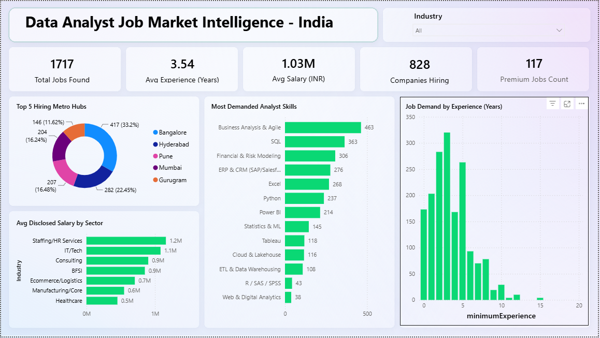

# 📊 India Data Analyst Job Market Intelligence 2026: End-to-End Medallion ETL & Analytics Pipeline

## 🎯 Project Overview
This project is an end-to-end data engineering and business intelligence analysis of the Data, BI, and Business Analyst job market in India. Rather than analyzing a pre-cleaned toy dataset, this repository demonstrates a reproducible **Bronze $\rightarrow$ Silver $\rightarrow$ Gold Medallion pipeline**: handling real-world data contamination, deduplicating syndicated recruitment spam, parsing unstructured salary bands via Regex, modeling a normalized **Skill-Bridge Star Schema** in SQL, and delivering executive insights in Power BI.

* **Engineering Changelog:**
  * **v1.0 (Initial Release):** Built DOM-diagnostic web scraping prototypes (`Selenium`/`BeautifulSoup`), initial Pandas/Excel data exploration, and baseline dashboarding.
  * **v2.0 (Medallion & Star Schema Refactor):** Engineered modular Python ETL (`04_Medallion_ETL_Pipeline.py`) with automated audit logging, fixed industry substring misclassifications, built a 2,695-row normalized skill-bridge table, expanded MySQL analytics with CTEs and Window Functions (`DENSE_RANK`), and upgraded the Power BI semantic model.

---

## ⚠️ Data Sourcing & The Analytical Funnel
Initially, this project built a custom web scraper targeting live job portals (`02_Web_Scraper.ipynb`). Due to dynamic DOM shifts and ethical compliance, the pipeline ingested the foundational [Indian Job Market Dataset 2025-2026](https://www.kaggle.com/datasets/shivamshrivastava21/indian-job-market-dataset-2025-2026) (97,000+ raw records) and executed a strict multi-stage validation funnel:

* **Bronze Layer (`bronze_analyst_jobs_raw.csv`):** Isolated **3,809 raw postings** containing `"Analyst"` in the job title.
* **Silver Layer (Deduplication & Noise Filtering):** Removed **615 duplicate/syndicated agency spam postings** and filtered out **1,477 non-analytics noise roles** (BPO call-auditing, medical coding, L1 service desk ticketing, and SOC security roles) that pollute naive keyword searches.
* **Gold Layer (`Master_Analyst_Data_Cleaned.csv` & `Gold_Bridge_Job_Skills.csv`):** Produced **1,717 strictly validated Analyst job postings** (including **376 Fresher 0–1 Yr roles**) across **828 unique hiring companies** and **2,695 standardized skill mappings**. Rather than deleting the 83% of MNC job postings with undisclosed salaries, the pipeline flags disclosed vs. undisclosed compensation (`Salary_Disclosed`) to preserve full market hiring volume while isolating **294 disclosed-salary roles** for accurate pay benchmarking.

---

## 🛠️ Technical Architecture & Stack

### 1. Reproducible Medallion ETL Pipeline (Python)
* **Libraries:** `pandas`, `numpy`, `re` (Regex), `os`, `datetime`
* **Key Techniques:**
  * **Regex Salary Extraction:** Parsed unstructured LPA figures embedded in job titles (e.g., `"7lpa"`, `"Up to 5.5 L"`) and nulled out sub-1 LPA monthly stipend anomalies.
  * **Domain Classification & Bug Prevention:** Ordered rule-based classification to separate `Direct Employers` from `Recruitment Agencies` first (preventing staffing firms with *"Manpower"* from misclassifying under *"Power/Manufacturing"*) and mapped skills to classify unknown employers—reducing unclassified `"Other"` roles from 43% to **13.2%**.
  * **Skill-Bridge Normalization:** Exploded and standardized messy comma-separated `tagsAndSkills` strings into a relational bridge table (`Gold_Bridge_Job_Skills.csv`) across 13 core skill groups.
  * **Pipeline Audit Logging:** Automated execution tracking (`ETL_Pipeline_Audit_Log.csv`) recording row counts, duplicates dropped, noise removed, and Regex matches per run.

### 2. Entry-Level Prototyping & Validation (Advanced Excel)
* **Execution:** Tested initial filtering rules and generated a targeted business deliverable (`Top_100_Fresher_Jobs_Excel_Extract.xlsx` / `.csv`) isolating the top-paying entry-level (0–1 year experience) analyst openings across India.

### 3. Dimensional Modeling & Exploratory Data Analysis (MySQL)
* **Script:** `4_SQL_Queries/04_Portfolio_Analysis_Queries.sql`
* **Key Techniques:**
  * Designed relational DDL tables (`job_postings` and `bridge_job_skills`) with Primary/Foreign key constraints.
  * Authored **CTEs (Common Table Expressions)** to calculate Fresher (0–1 Yr) market share across 6 analytical career tracks (`Business & Product Analyst`, `Financial & Risk Analyst`, `Operations & General Analyst`, `Data Analyst`, `BI & Reporting Analyst`, `Data Engineering & ETL`).
  * Joined the fact table with the skill bridge table to compute **Skill-to-Salary ROI** and used **Window Functions (`DENSE_RANK() OVER (PARTITION BY Clean_City...)`)** to isolate the top 3 highest-paying roles per metro hub.
  * Created a pre-aggregated Gold reporting view (`vw_gold_analyst_market`) with standardized Experience Bands and Compensation Tiers.

### 4. Interactive Executive Dashboard (Power BI)
* **Deliverable:** `5_PowerBI/05_India_Analyst_Dashboard.pbix`
* **Key Techniques:**
  * Connected the 1-to-Many relational model (`Master_Analyst_Data_Cleaned` $\rightarrow$ `Gold_Bridge_Job_Skills`) on `jobId`.
  * Built custom DAX measures tracking **Total Validated Jobs (1,717)**, **Unique Hiring Companies (828)**, **Avg Experience (3.54 Years)**, **Avg Disclosed Salary (₹10.30 LPA / 1.03M INR)**, and **Premium Roles $\ge$ ₹10 LPA (117)**.

---

## 📈 Executive Dashboard

## 💡 Key Validated Market Insights
1. **Skill Demand Hierarchy:** Across 2,695 extracted skill tags, **Business Analysis & Agile (463 jobs)** and **SQL (363 jobs)** are the most demanded core competencies, followed by **Financial & Risk Modeling (306)**, **ERP/CRM Systems (276)**, **Advanced Excel (268)**, **Python (237)**, and **Power BI (214)**.
2. **Geographic Concentration:** **Bangalore** dominates the top 5 metro hubs with **417 validated openings (33.2%)**, followed by **Hyderabad (282 jobs, 22.45%)**, **Pune (207 jobs, 16.48%)**, **Mumbai (204 jobs, 16.24%)**, and **Gurugram (146 jobs, 11.62%)**.
3. **The Experience Bottleneck:** While **376 openings (21.9%)** accept freshers with **0 to 1 year of experience**, hiring volume peaks sharply between **2 to 5 years of experience**, confirming the industry demand for analysts who can independently own SQL, ETL, and BI workflows.
4. **Compensation Benchmarks:** Among the 294 roles that publicly disclose salaries, the market average sits at **₹10.30 LPA (1.03M INR)**, with **117 roles** offering premium compensation ($\ge$ ₹10 LPA), led by specialized IT/Tech, Consulting, and BFSI roles.

---

## 📂 Repository Structure
* `1_Raw_Data/`: Contains `bronze_analyst_jobs_raw.csv` (the 3,809-row raw Analyst subset extracted from the 97k Kaggle dataset) so the ETL pipeline can be cloned and executed reproducibly.
* `2_Python_Scripts/`:
  * `01_Data_Exploration.ipynb`: Initial schema exploration of the 97k raw dataset.
  * `02_Web_Scraper.ipynb`: R&D DOM-diagnostic web scraping prototype using Selenium and BeautifulSoup.
  * `03_Data_Cleaning.ipynb` & `04_Medallion_ETL_Pipeline.py`: Production Bronze $\rightarrow$ Silver $\rightarrow$ Gold ETL script with Regex parsing, deduplication, noise filtering, and skill-bridge generation.
* `3_Cleaned_Data/`: Output Gold layer datasets (`Master_Analyst_Data_Cleaned.csv`, `Gold_Bridge_Job_Skills.csv`, `Excel_Analysis_Sample.csv`, `Top_100_Fresher_Jobs_Excel_Extract.xlsx`, and `ETL_Pipeline_Audit_Log.csv`).
* `4_SQL_Queries/`: `04_Portfolio_Analysis_Queries.sql` containing Star Schema DDL, CTEs, Skill-Bridge joins, Window Functions, and Gold BI View definitions.
* `5_PowerBI/`: `05_India_Analyst_Dashboard.pbix` interactive report.

---
## 📬 Let's Connect
* **LinkedIn:** [www.linkedin.com/in/datashish](https://www.linkedin.com/in/datashish)
* **Email:** ashishmis24@gmail.com
